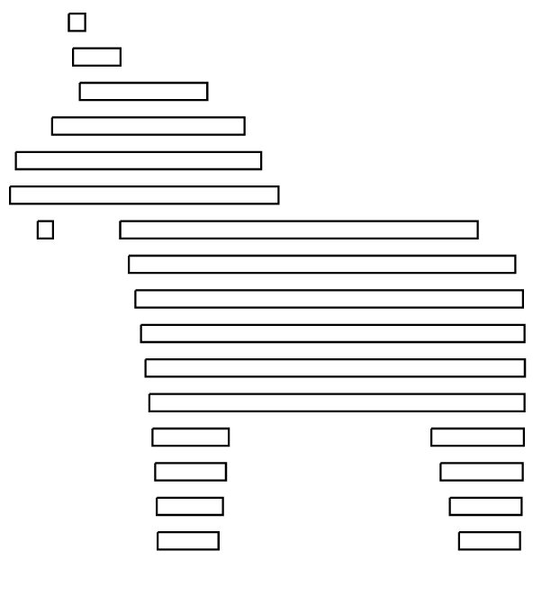
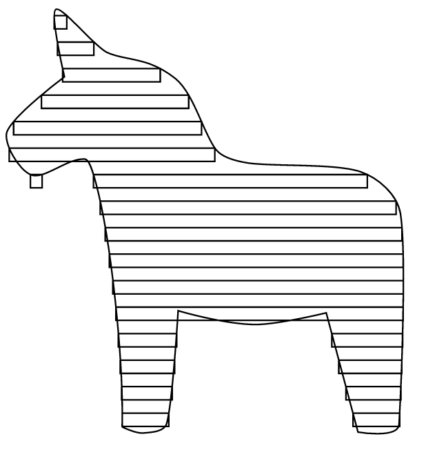
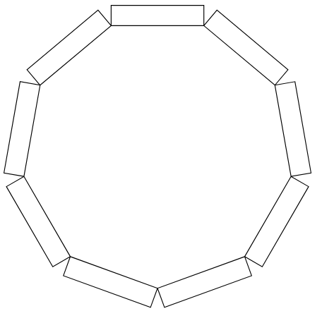

==========
Components
==========

Below are the set of built-in components.  Additional custom components are available
via ``custom components``

----------------------------------------------------------------

draw
=====
The draw component provides the basic drawing primitives to make shapes.  The draw commands
mostly correspond to svg path commands, but there are some useful additions.

Draw component should be in the form:

.. code-block::

    {
        "id": "my_drawing",
        "type": "draw",
        "commands": [
            {
                "command": "move",
                "to": "2,2"
            }
        ]
    }

Commands
^^^^^^^^

* ``move`` Move the cursor to this position
    * ``to`` Point where to move to
* ``rel_move`` Move, with relative position.  This means that if the current position is 
                3,4 and ``to`` is 1,1 then the final position will be 4,5.
    * ``to`` Relative point
* ``line`` Draw a line to the requested point
    * ``to`` Point to draw a line to
* ``rel_line`` Same as line only using relative coords
    * ``to`` relative point
* ``line_by_angle`` Draw a line from current position by an angle and length
    * ``angle`` angle in degrees
    * ``length`` length of the line
* ``curve`` Draw a cubic bezier curve.
    * ``to``
    * ``ctrl_start``
    * ``ctrl_end``
* ``rel_curve`` Same as curve, but all points are relative
* ``smooth_curve`` A curve where the start control point is reflected from the
        end control point of the previous curve
    * ``to``
    * ``ctrl_end``
* ``rel_smooth_curve`` Same as ``smooth_curve`` with points relative
* ``circle`` Draw a circle
    * ``radius``
* ``rectangle`` Draw a rectangle
    * ``width``
    * ``height``
* ``round_corner`` Draws a 90 degree rounded corner
    * ``to`` The endpoint of the corner
    * ``radius`` the radius of the curve
    * ``corner`` The point where the corner would appear
* ``rel_round_corner``
* ``svg`` Draws an svg 'Path' 
    * ``svg`` The svg path string, (ex: "M 2,2 L 0,0").
* ``svg_scale_to`` Similiar to ``svg`` command. This is a special draw command which scales 
        the svg x and y so that the start point aligns with the previous endpoint and the endpoint 
        aligns to 'to'.  Note, this does not rotate the shape, it only scales in x and y.
    * ``svg`` The svg path string, (ex: "M 2,2 L 0,0").   
    * ``to`` Where to draw the svg to. 
    * ``reverse`` if true this will reverse the path        
* ``rel_svg_scale_to`` Samce as ``svg_scale_to`` but ``to`` is using relative coodrdinates
* ``svg_connect_to`` Similiar to ``svg_scale_to`` command. This is a special draw command which scales 
        and rotates the svg x and y so that the start point aligns with the previous endpoint and the endpoint 
        aligns to 'to'.
    * ``svg`` The svg path string, (ex: "M 2,2 L 0,0").   
    * ``to`` Where to draw the svg to. 
    * ``svg_from`` The starting point in the SVG to use as the connection point.  By
        default this is the start of the path
    * ``svg_to`` The end point in the SVG to use as the connection point.  By 
        default this is the end of the path
    * ``reverse`` if true this will reverse the path. Default is false       
* ``rel_svg_connect_to`` Same as ``svg_connect_to`` but ``to`` is using relative coodrdinates

----------------------------------------------------------------

group
=====

.. topic:: Examples

    * `<https://github.com/dustismo/heavyfishdesign/tree/master/designs/component_examples/svg_connect.hfd>`_

group component is an easy way to group components together. 
For instance, this provides a way to do a transform on multiple components, without applying to the
entire part

Parameters
^^^^^^^^^^

* ``components``: An array of components.

                        
----------------------------------------------------------------

basic_edge
==========

.. topic:: Examples

    * `<https://github.com/dustismo/heavyfishdesign/tree/master/designs/joints/line.hfd>`_

an edge is some form of a connection from x1,y1 to x2,y2.  

Typically an edge will be written to be reused as a custom component, where the ``to`` and ``from`` params are 
passed in. 

Parameters
^^^^^^^^^^

* ``handle``: When moving the edge what point should be considered the start.  Defaults
    to $ORIGIN
* ``to``: The point the edge should be drawn to
    The to point can take the following forms:

        .. code-block::

            x, y

        .. code-block::

            {
                "x": 5,
                "y": 6
            }

        .. code-block::

            {
                "angle" : 90,
                "length" : 5
            }
            // angle is in degrees where 0 is a straight line to
            // the right, and 90 is a line pointing to positive Y
   
* ``from``: The point the edge should be drawn from.  Defaults to current position
* ``edge_variable_name``: This is a special feature, if you set this name then certain Attributes of this edge will be available to all subsequently rendered components. See Global Variables

Global Variables
^^^^^^^^^^^^^^^^

* ``<edge_variable_name>__length``: length of this edge
* ``<edge_variable_name>__angle``: the angle of this edge

----------------------------------------------------------------

repeat_edge
===========

.. topic:: Examples

    * `<https://github.com/dustismo/heavyfishdesign/tree/master/designs/joints/finger_joint_plug.hfd>`_

an edge is some form of a connection from x1,y1 to x2,y2.  Edges are specifically designed to be useful
for joints, but can easily be used for other things.  

The repeat edge is a special variety of edge, that contains some repeatable element.
Each repeat edge contains three subcomponents left, repeatable, right.  (i.e. beginning, middle, end).
Each of the subcomponents should be drawn horizontally from origin 0,0.  The component
will stitch them together to make a continuous edge, and handle automatically handle 
moving and rotating. 

Typically an edge will be written to be reused, where the ``to`` and ``from`` params are 
passed in. 

Parameters
^^^^^^^^^^

* ``padding_left``: Additional amount that should be used on the left side before
    the repeatable starts
* ``padding_right``: see ``padding_left``
* ``handle``: When moving the edge what point should be considered the start.  Defaults
    to $ORIGIN
* ``to``: The point the edge should be drawn to
    The to point can take the following forms:

        .. code-block::

            x, y

        .. code-block::

            {
                "x": 5,
                "y": 6
            }

        .. code-block::

            {
                "angle" : 90,
                "length" : 5
            }
            // angle is in degrees where 0 is a straight line to
            // the right, and 90 is a line pointing to positive Y
   
* ``from``: The point the edge should be drawn from.  Defaults to current position
* ``left``: This should be a renderable component. it is the left most part of the edge.
	this should be stretchable and contains a special param
	called ``left_width``.  
* ``repeatable``: This should be a renderable component. it is the middle section, which will be repeated as many times as needed
* ``right``: Same as left, but has ``right_width`` special param
* ``edge_variable_name``: This is a special feature, if you set this name then certain Attributes of this edge will be available to all subsequently rendered components. See Global Variables

Global Variables
^^^^^^^^^^^^^^^^

* ``<edge_variable_name>__length``: length of this edge
* ``<edge_variable_name>__angle``: the angle of this edge

------------------------------------------------------------------------------------------

xintercept
==========

.. topic:: Examples

    * `<https://github.com/dustismo/heavyfishdesign/blob/master/designs/game_cabinet/speaker.hfd>`_

xintercept is a special component that allows you to render a repeatable shape horizontally 
into another shape. 

This is best described visually.  Here we have an outline of a dala horse, and 
we are drawing rectangles within it.  

And here it is if the outline were drawn in.

Parameters
^^^^^^^^^^

* ``outline``: <component> The shape that the repeatable should be drawn into 
* ``repeatable``: <component> The shape that should be repeated.  The repeatable
    shape will have params passed down to allow it to render the 
    proper size (see Local Variables). 
* ``initial_spacing``: how much initial vertical space to add before drawing the first repeatable.
* ``repeat_spacing``: how much vertical space between each repeatable.

Local Variables
^^^^^^^^^^^^^^^

* ``xintercept__length`` The horizontal length of this piece
* ``xintercept__to__x`` The point to draw to
* ``xintercept__to__y`` The point to draw to
* ``xintercept__from__x`` The point to start from
* ``xintercept__from__y`` The point to start from

------------------------------------------------------------------------------------------

around
======

.. topic:: Examples

    * `<https://github.com/dustismo/heavyfishdesign/blob/master/designs/component_examples/around.hfd>`_

around is a component that allows you to render a repeatable shape N number of times around a circle.

Here we have a rectangle repeated nine times with a radius of 2.  

Parameters
^^^^^^^^^^

* ``center_point``: Where the center of the circle should be
* ``repeatable``: <component> The shape that should be repeated.  The shape should 
    be rendered horizontally.  The component will automatically move and rotate into the 
    proper position. The repeatable
    shape will have params passed down to allow it to render the 
    proper size. (see Local Variables) 
* ``num_edges``: the number of edges to draw.  (i.e. 5 edges would be a pentagon)
* ``radius``: The radius of the circle.  Note the start and end of the repeatable will be this distance from the center point

Local Variables
^^^^^^^^^^^^^^^

* ``around__length`` The horizontal length of this peice
* ``around__index`` The index of this piece. 0 to num_edges-1

------------------------------------------------------------------------------------------

gear
======

.. topic:: Examples

    * `<https://github.com/dustismo/heavyfishdesign/blob/master/designs/component_examples/gear.hfd>`_

Renders a basic involute gear, suitable for most things. By default the Gear is rendered where 0,0 is the center point. 

Parameters
^^^^^^^^^^

* ``teeth``: number of teeth on the gear
* ``tooth_width``: the width of a single tooth.
* ``pressure_angle``: defaults to 20 
* ``clearance``: defaults to 0.01
* ``backlash``: defaults to 0.01
* ``gear_variable_name``: if you set this name then certain Attributes of this gear will be available to all subsequently rendered components. See Global Variables

Global Variables
^^^^^^^^^^^^^^^^

* ``<gear_variable_name>__outer_radius``: The radius from center to tooth tip
* ``<gear_variable_name>__inner_radius``: The radius from center to lowest valley

------------------------------------------------------------------------------------------

pattern
=======

.. topic:: Examples

    * `<https://github.com/dustismo/heavyfishdesign/blob/master/designs/component_examples/pattern_grids.hfd>`_
    * `<https://github.com/dustismo/heavyfishdesign/blob/master/designs/component_examples/pattern_strokes.hfd>`_

Closed cutout grids. Each hole is its own subpath. ``width``, ``height``, and ``margin`` are inches. The grid is centered in the inner margin. ``clip_to_border`` keeps holes that cross that rectangle and cuts them at the margin.

``kind`` selects the grid:

* ``hexagon_grid``: pointy-top hexes. ``circumradius`` (default 0.35) and ``gap`` (default 0.2).
* ``hex_circles``: honeycomb-packed circles. ``radius`` (default 0.35) and ``gap`` (default 0.2).
* ``lens_grid``: lens holes. ``lens_length`` (default 0.72), ``lens_width`` (default 0.44), ``lean_deg`` (default 36), ``gap_x`` (default 0.13), ``gap_y`` (default 0.11). Neighbors lean the opposite way.
* ``hatch``: centerlines of parallel lines. ``angle_deg`` (default 45), ``spacing`` (default 0.5), ``phase`` (default 0). ``cross`` (default false) adds a second family at ``cross_angle`` (default 90).
* ``wave_lattice``: centerlines of stacked sines, as cubic curves. The top crest and the bottom trough pass the margin by half the stroke width, so once stroked those peaks open through the top and bottom edges. ``amplitude`` (default 0.15), ``wavelength`` (default 1.2), ``ribbon_thickness`` (default 0.25), ``ribbon_gap`` (default 0.3), ``phase_step`` (default 0.4 radians), ``samples`` (default 48) is how many curves span the panel. ``clip_to_border`` cuts centerlines that cross the margin.
* ``staggered_lattice_lines``: centerlines of the staggered fretwork. ``rect_width`` (default 0.5), ``rect_height`` (default 1.25), ``v_gap_ratio`` (default 0.4), ``h_gap_ratio`` (default 0.95).
* ``overlapping_circles``: jittered rings subtracted from the panel. Each ring is a circle of the given radius, ``stroke_width`` thick (default 0.08). Where rings cross, the outline keeps those circular arcs instead of a flattened union. ``radius_min`` (default 0.25), ``radius_max`` (default 0.6), ``count`` (default 30), ``seed`` (default 17). ``count`` 0 is the panel rectangle only.
* ``voronoi``: seeded sites inside the margin, then the cell edges thickened and unioned. Three edges meet at a vertex, so each edge is stroked on its own and the strokes are unioned. A border of half the stroke width runs inside the margin, and the slots that reach it join that border. ``site_count`` (default 32), ``seed`` (default 7), ``min_site_gap`` (default 0.2), ``thickness`` (default 0.25). A thickness of 0 keeps the centerlines and skips the border.

The stroked panels are custom components. Each one is a ``framed_stroke`` around the matching centerlines, with ``fit`` left off so the lines stay in panel coordinates. Import ``designs/component_examples/hatch.hfd``, ``wave_lattice.hfd``, or ``staggered_lattice.hfd``. ``thickness`` is the stroke width. ``frame`` defaults to false for hatch and waves, and true for the lattice. The lattice uses a round join, so each cell corner is a quarter-circle of half the stroke width.

----------------------------------------------------------------

framed_stroke
=============

.. topic:: Examples

    * `<https://github.com/dustismo/heavyfishdesign/blob/master/designs/component_examples/framed_stroke.hfd>`_

Thickens a child line drawing. ``components`` is any list of components that draw centerlines (a ``draw`` with ``svg``, lines, or another component).

The child drawing is scaled with the shared scale transform so its bounding box fills the inner margin, then moved so that corner sits on the margin. Set ``fit`` to false to leave a drawing that is already in panel coordinates. The stroke then offsets both sides of each continuous path and joins the corners, clips the result to that margin, and unions it with a frame. Set ``frame`` to false to skip the frame. An open end that meets the frame is extended through that edge before the stroke, so the opening follows the line. A subpath that returns to its start is closed, so the join applies to that corner. ``join`` is ``miter`` (default) or ``round``. A round join puts a quarter-circle of radius half the stroke width on each convex corner. ``width``, ``height``, and ``margin`` are the panel, in inches. ``thickness`` (default 0.1) is the stroke width. A thickness of 0 keeps the centerlines and does not draw the frame.

Parameters
^^^^^^^^^^

* ``components``: the line drawing to thicken
* ``width``, ``height``, ``margin``: the panel and its inner margin
* ``thickness``: full stroke width, in inches
* ``fit``: scale the drawing to the inner margin (default true)
* ``frame``: union the perimeter band (default true)
* ``join``: ``miter`` (default) or ``round``
